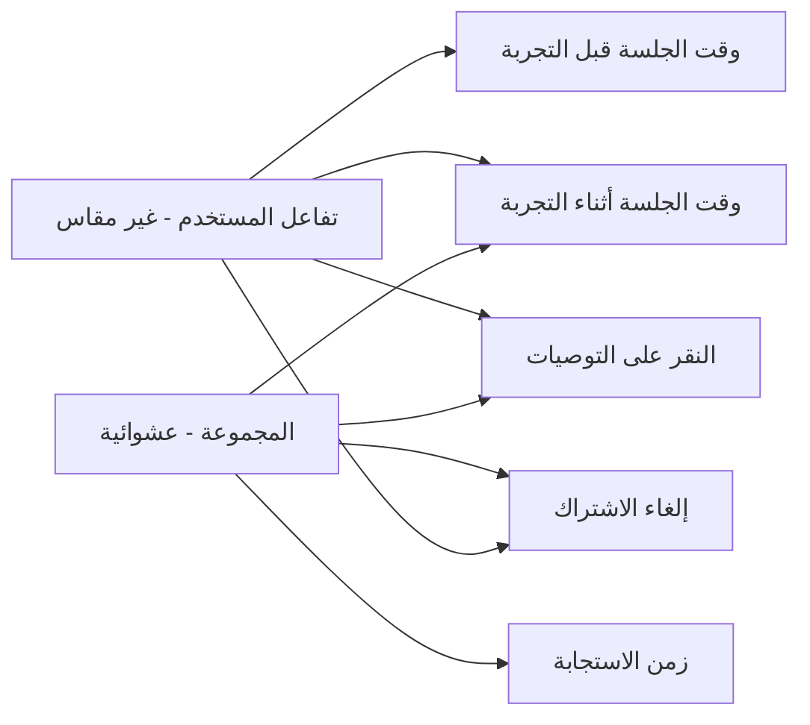
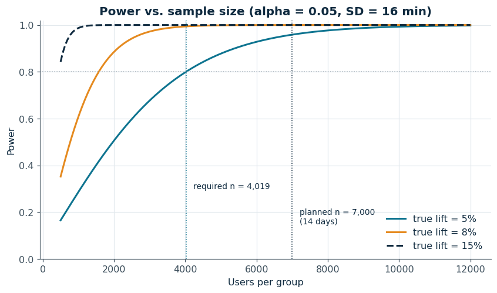
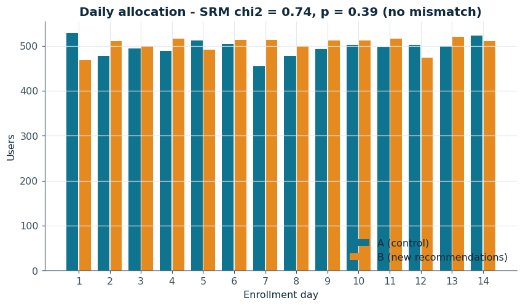
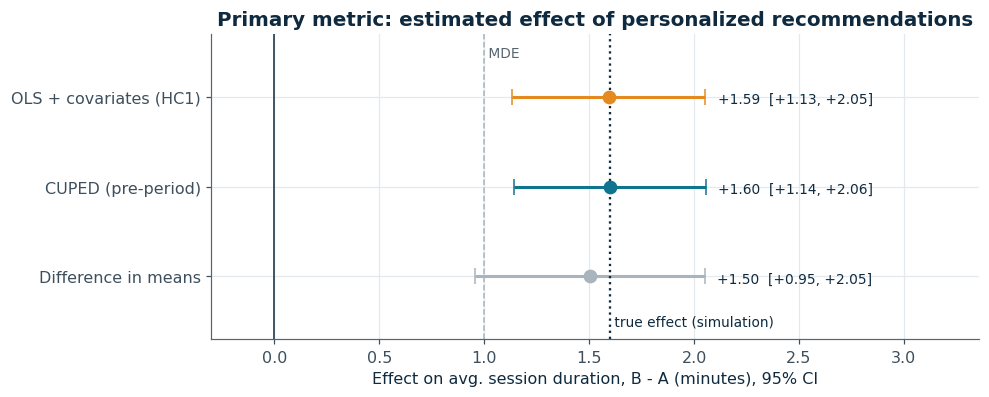
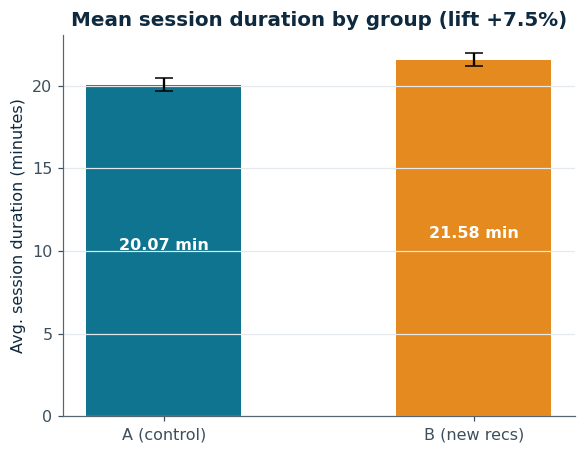
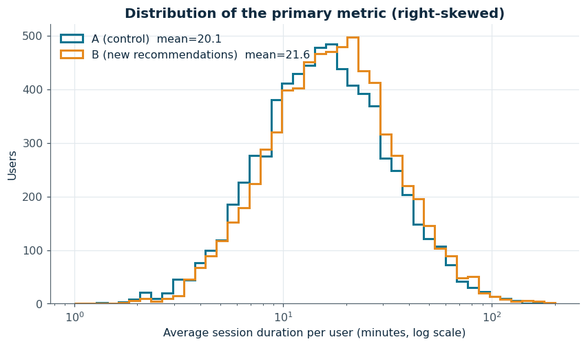
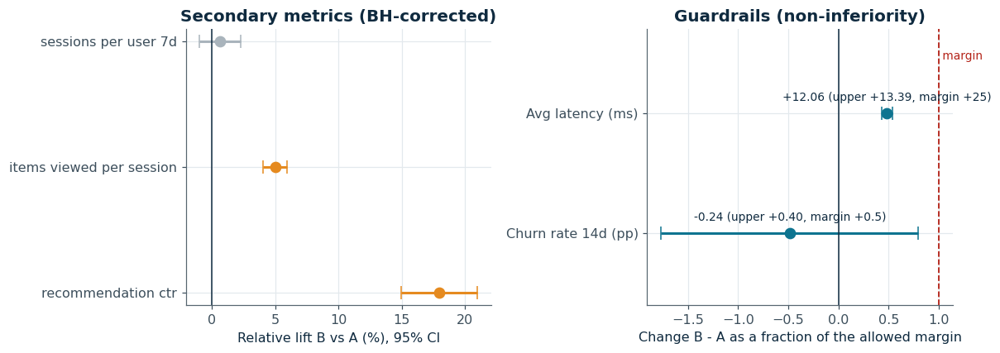
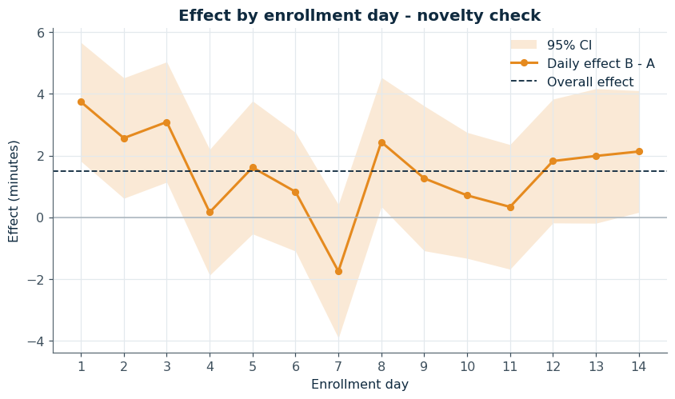
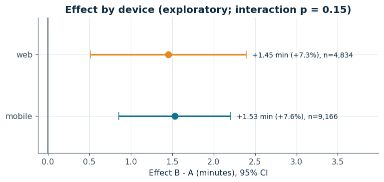
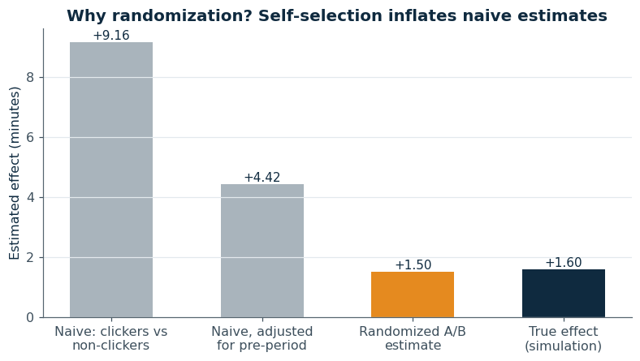

<div dir="rtl">

# اختبار A/B لنموذج التوصيات المخصصة وأثره على وقت جلسة المستخدم

**Personalized Recommendations A/B Test — Session Duration**

**الفريق | Team:** هذال السبيعي (Hathal Alsubaie) · نواف السياري (Nawaf Alsayari) · عبد الإله الحربي (Abdulelah Alharbi) · سند الخمعلي (Sanad Alkhamali)

المشروع الختامي لبرنامج **التجارب واختبارات A/B والاستدلال السببي (A/B Testing and Causal Inference)** — أكاديمية سدايا، نوفمبر 2026.
حساب أكاديمية سدايا على GitHub: https://github.com/SDAIAAcademy

---

## 0. بيانات المشروع

| البند | القيمة |
|---|---|
| اسم المشروع | اختبار A/B لنموذج التوصيات المخصصة (Data Science) |
| أعضاء الفريق | هذال السبيعي (Hathal Alsubaie)<br>نواف السياري (Nawaf Alsayari)<br>عبد الإله الحربي (Abdulelah Alharbi)<br>سند الخمعلي (Sanad Alkhamali) |
| الجهة | أكاديمية سدايا (مشروع تدريبي على منصة محتوى رقمي افتراضية) |
| الخدمة محل الدراسة | قسم «مقترح لك» في منصة مشاهدة محتوى |
| القرار المطلوب | هل نعتمد نموذج التوصيات الجديد القائم على سلوك المشاهدة ونطلقه لكل المستخدمين؟ |

## 1. المشكلة والهدف

تعرض المنصة حاليًا توصيات عامة (الأكثر مشاهدة)، فيقضي المستخدم وقتًا في البحث عن محتوى يناسبه، وتنتهي جلسات كثيرة مبكرًا.
طوّر الفريق نموذج توصيات مخصصًا يعتمد على سجل نشاط المستخدم. **الهدف:** تقدير الأثر السببي لهذا النموذج على تفاعل المستخدمين، ثم الوصول إلى قرار إطلاق مبني على الأدلة.

## 2. السؤال والفرضية

- **السؤال الرئيسي:** هل يؤدي عرض توصيات مخصصة مبنية على سجل المشاهدة إلى زيادة متوسط وقت جلسة المستخدم؟
- **الفرضية:** إذا طبقنا خوارزمية التوصيات المخصصة، فسوف يرتفع متوسط وقت الجلسة بنحو **15%**، لأن المحتوى القريب من اهتمام المستخدم يقلل وقت البحث ويزيد استمراره في المنصة.
- **المعالجة:** نموذج التوصيات الجديد (B) مقابل التوصيات العامة الحالية (A).
- **اتجاه الأثر المتوقع:** موجب (زيادة وقت الجلسة).
- **ما الذي يجعلنا نغير رأينا:** عدم وجود فرق ذي دلالة في وقت الجلسة، أو ارتفاع معدل إلغاء الاشتراك (Churn)، أو تدهور زمن استجابة الخادم بسبب النموذج.

## 3. تصميم التجربة

| العنصر | القيمة |
|---|---|
| نوع الدراسة | تجربة عشوائية مضبوطة (A/B Test) — التوزيع العشوائي ممكن لأن التوصيات تُعرض لكل مستخدم على حدة |
| المجتمع المستهدف | المستخدمون الجدد في التجربة الذين يفتحون المنصة خلال فترة التسجيل (جوال وويب) |
| وحدة العشوائية | **المستخدم (User)** — وليس الجلسة، حتى لا يرى المستخدم نسختين مختلفتين |
| المجموعة المعالجة B | تشاهد قسم «مقترح لك» من النموذج الجديد |
| المجموعة الضابطة A | تشاهد التوصيات الحالية (الوضع القائم) |
| نسبة التوزيع | 50% / 50% |
| طريقة التوزيع | Hash حتمي: `md5(salt:user_id) mod 10000 < 5000 → B`، فيبقى المستخدم في نفس المجموعة طوال التجربة ويمكن إعادة التحقق من التوزيع |
| مدة التسجيل | 14 يومًا (أسبوعان كاملان لتغطية دورة الأسبوع) |
| نافذة القياس | أول 7 أيام لكل مستخدم بعد أول تعرض، ثم يُجرى التحليل النهائي بعد اكتمال نافذة آخر مستخدم |
| شرط SUTVA | تغيير التوصيات لمستخدم لا يؤثر في سلوك مستخدم آخر (لا توجد ميزة مشاركة اجتماعية في القسم) |

### الرسم السببي (DAG)



لأن المجموعة تُحدد عشوائيًا، لا يوجد سهم من «تفاعل المستخدم» إلى «المجموعة»، فالمقارنة البسيطة بين A وB تعطي تقديرًا غير متحيز للأثر السببي. أما مقارنة «من نقر على التوصيات» بـ«من لم ينقر» فهي متحيزة، لأن النقر نفسه يتأثر بتفاعل المستخدم (متغير مُربك) — وهذا ما يوضحه القسم 8.

## 4. المقاييس

| النوع | المقياس | التعريف |
|---|---|---|
| **المقياس الرئيسي** | متوسط وقت الجلسة لكل مستخدم (دقيقة) | متوسط مدة الجلسة لكل مستخدم خلال نافذة 7 أيام |
| ثانوي | معدل النقر على التوصيات (CTR) | مجموع النقرات ÷ مجموع مرات الظهور (مقياس نسبة، يُحلل بطريقة Delta) |
| ثانوي | عدد العناصر المشاهدة لكل جلسة | متوسط لكل مستخدم |
| ثانوي | عدد الجلسات لكل مستخدم (7 أيام) | |
| **مقياس حماية** | معدل إلغاء الاشتراك خلال 14 يومًا (Churn) | يجب ألا يزيد أكثر من **+0.5 نقطة مئوية** |
| **مقياس حماية** | متوسط زمن استجابة الخادم (Latency) | يجب ألا يزيد أكثر من **+25 ms** |

## 5. حجم العينة والمدة

الحساب في [`src/power_analysis.py`](src/power_analysis.py) بمعادلة الفرق بين متوسطين:

n لكل مجموعة = 2 × (z<sub>1−α/2</sub> + z<sub>القوة</sub>)² × σ² ÷ δ²

| المعامل | القيمة | المصدر / الافتراض |
|---|---|---|
| مستوى الدلالة α | 0.05 (اختبار ثنائي الاتجاه) | |
| القوة الإحصائية | 80% | |
| متوسط وقت الجلسة الحالي | 20 دقيقة | بيانات تاريخية (افتراض) |
| الانحراف المعياري σ | 16 دقيقة | بيانات تاريخية (افتراض) — التوزيع ملتوٍ لليمين |
| أصغر أثر مهم (MDE) | **+5% = 1 دقيقة** | أصغر زيادة تبرر تكلفة تشغيل النموذج |
| حجم العينة المطلوب | **4,019 لكل مجموعة (8,038 إجمالًا)** | |
| المستخدمون يوميًا | 1,000 | |
| الأيام اللازمة | 9 أيام ← تُقرّب إلى **14 يومًا** (أسبوعان كاملان) | لتغطية أيام الأسبوع وتقليل أثر الحداثة |
| العينة المخططة | 7,000 لكل مجموعة | MDE الفعلي = 0.76 دقيقة (3.8%)، والقوة لاكتشاف 5% ≈ 96% |

ملاحظة: لاكتشاف أثر 15% (كما في الفرضية) يكفي نحو 450 مستخدمًا لكل مجموعة، لكننا صممنا التجربة لاكتشاف 5% لأن أثرًا أصغر من 15% ما زال مهمًا تجاريًا.



## 6. خطة التحليل (كُتبت قبل إنشاء البيانات)

1. **فحص SRM:** اختبار مربع كاي على أعداد المجموعتين، ونعتبر وجود خلل إذا كانت p < 0.001 (ويتوقف التحليل).
2. **المقياس الرئيسي:** الفرق بين المتوسطين (B − A) مع فترة ثقة 95% وقيمة p (اختبار Welch بالتقريب الطبيعي)، والأثر النسبي بطريقة Delta.
3. **تقليل التباين:** CUPED باستخدام متوسط وقت الجلسة في آخر 30 يومًا قبل التجربة، وانحدار OLS مع متغيرات مساعدة وأخطاء معيارية متينة (HC1) للتحقق، واختبار Mann-Whitney للتحقق من حساسية النتيجة للالتواء.
4. **المقاييس الثانوية:** تصحيح الاختبارات المتعددة بطريقة Benjamini-Hochberg.
5. **مقاييس الحماية:** اختبار عدم التدهور: الحد الأعلى لفترة الثقة 95% يجب أن يكون أقل من الهامش المسموح.
6. **تحليلات استكشافية:** الأثر حسب الجهاز (مع اختبار التفاعل)، والأثر حسب يوم التسجيل (فحص أثر الحداثة).
7. **متى نحلل:** مرة واحدة بعد اكتمال المدة المخططة (بدون نظرات مبكرة Peeking).
8. **قاعدة القرار:**
   - الحد الأعلى لفترة الثقة < 0 ← لا نطلق.
   - الحد الأدنى > 0 مع تدهور مقياس حماية ← لا نطلق الآن، نعالج ثم نعيد.
   - الحد الأدنى > 0 ومقاييس الحماية سليمة ← **نطلق**.
   - الحد الأعلى < MDE ← لا نطلق (الأثر أصغر من أن يهم).
   - غير ذلك ← غير حاسم، نمدد أو نعيد التصميم.

## 7. البيانات وفحوص الجودة

**البيانات محاكاة (Simulated)** — كما هو مطلوب في البرنامج، لأننا لا نملك بيانات حقيقية؛ وميزة المحاكاة أننا نعرف الأثر الحقيقي فنتحقق هل يصل إليه التحليل.
المحاكاة في [`src/simulate_data.py`](src/simulate_data.py) ببذرة ثابتة (2026) فتتكرر النتائج نفسها في كل تشغيل.

**افتراضات المحاكاة («الحقيقة» المخفية):**
- وقت الجلسة لوغاريتمي-طبيعي (متوسط ≈ 20 دقيقة، σ ≈ 16)، ويرتبط بوقت الجلسة قبل التجربة (ρ ≈ 0.55) عبر متغير «تفاعل المستخدم» غير المقاس.
- الأثر الحقيقي للنموذج: **+8%** في المتوسط (≈ +1.60 دقيقة)، أكبر قليلًا على الجوال، مع أثر حداثة في الأيام الأولى.
- CTR: +20% نسبيًا، العناصر لكل جلسة: +5%، Churn: −0.2 نقطة، زمن الاستجابة: +12 ms.
- مشاكل بيانات مقصودة: 0.3% سجلات مكررة (خلل تسجيل)، و1% قيم مفقودة في زمن الاستجابة.

**ملف البيانات:** `data/raw_experiment_data.csv` (صف لكل مستخدم) — الأعمدة:
`user_id, variant, enroll_day, device, pre_avg_session_min_30d, avg_session_min, sessions_7d, items_viewed_per_session, rec_impressions, rec_clicks, churned_14d, avg_latency_ms`

**نتائج الفحوص** ([`src/data_quality.py`](src/data_quality.py)):

| الفحص | النتيجة |
|---|---|
| اكتمال الأعمدة | كل الأعمدة المطلوبة موجودة |
| السجلات المكررة | حُذف **42** سجلًا مكررًا ← 14,000 مستخدم فريد |
| القيم المفقودة | 152 قيمة في `avg_latency_ms` فقط ← استُبعدت من مقياس الحماية فقط (بدون تعويض) |
| فحص القيم (سالبة، نقرات > ظهور) | لا توجد مخالفات |
| سلامة التوزيع (إعادة حساب الـ Hash) | 0 حالات عدم تطابق |
| **SRM** | A = 6,949، B = 7,051، χ² = 0.74، **p = 0.39** ← التوزيع سليم، ولا يوجد يوم فيه خلل |
| توازن المتغيرات قبل التجربة (SMD) | أكبر قيمة 0.010 (< 0.1) ← المجموعتان متوازنتان |



## 8. النتائج

### المقياس الرئيسي: متوسط وقت الجلسة

| | القيمة |
|---|---|
| المجموعة الضابطة A | **20.07** دقيقة (n = 6,949) |
| المجموعة المعالجة B | **21.58** دقيقة (n = 7,051) |
| الأثر (B − A) | **+1.50 دقيقة** — فترة الثقة 95%: [+0.95، +2.05]، **p = 7.9×10⁻⁸** |
| الأثر النسبي | **+7.5%** — فترة الثقة 95%: [+4.7%، +10.3%] |
| مع CUPED | +1.60 دقيقة [+1.14، +2.06] — انخفاض التباين 30% (فترة ثقة أضيق) |
| انحدار OLS مع متغيرات مساعدة | +1.59 دقيقة [+1.13، +2.05] |
| Mann-Whitney | p = 5.4×10⁻¹² (النتيجة ليست بسبب قيم متطرفة) |
| الأثر الحقيقي في المحاكاة | +1.60 دقيقة ← كل الطرق تحتوي القيمة الحقيقية داخل فترة الثقة |



 

### المقاييس الثانوية (بعد تصحيح Benjamini-Hochberg)

| المقياس | A | B | الأثر النسبي | p بعد التصحيح | الحالة |
|---|---|---|---|---|---|
| معدل النقر على التوصيات (CTR) | 6.52% | 7.69% | +18.0% | 1.2×10⁻³⁵ | دال |
| العناصر المشاهدة لكل جلسة | 4.05 | 4.25 | +5.0% | 3.7×10⁻²⁶ | دال |
| عدد الجلسات لكل مستخدم | 4.11 | 4.14 | +0.6% | 0.43 | غير دال |

التفسير: النموذج يجعل الجلسة أطول وأغنى (نقرات وعناصر أكثر)، لكنه لا يزيد عدد مرات العودة للمنصة خلال الأسبوع الأول.

### مقاييس الحماية

| المقياس | A | B | الفرق [95% CI] | الهامش | الحالة |
|---|---|---|---|---|---|
| إلغاء الاشتراك (14 يومًا) | 4.01% | 3.77% | −0.24 نقطة [−0.88، +0.40] | +0.5 نقطة | ✅ سليم |
| زمن استجابة الخادم | 179.6 ms | 191.7 ms | +12.1 ms [+10.7، +13.4] | +25 ms | ✅ سليم (ارتفاع حقيقي لكنه ضمن المسموح) |



### تحليلات استكشافية

- **أثر الحداثة:** الأثر +1.47 دقيقة في الأسبوع الأول و+1.54 في الأسبوع الثاني، فلا يوجد دليل على أن الأثر يختفي مع الوقت (الأيام 1–3 أعلى قليلًا لكن بفترات ثقة واسعة).
- **حسب الجهاز:** الجوال +7.6% والويب +7.3%، واختبار التفاعل p = 0.15 ← لا يوجد دليل على اختلاف الأثر بين الأجهزة.




### لماذا نحتاج التجربة العشوائية؟

لو قارنّا داخل المجموعة B بين من نقر على التوصيات ومن لم ينقر (تحليل رصدي ساذج) لحصلنا على أثر **+9.16 دقيقة**، وحتى بعد ضبط وقت الجلسة السابق يبقى **+4.42** — أي ما يقارب 3–6 أضعاف الأثر الحقيقي (+1.60)، لأن المستخدمين الأكثر تفاعلًا ينقرون أكثر ويبقون أطول أصلًا (تحيز الاختيار الذاتي). التجربة العشوائية أعطت **+1.50** وهو قريب جدًا من الحقيقة.



## 9. التوصية النهائية

### ✅ القرار: إطلاق النموذج الجديد (SHIP)

- **الأهمية الإحصائية:** الأثر موجب بثقة؛ فترة الثقة 95% كاملة فوق الصفر [+0.95، +2.05] وp < 0.001، ونتيجة CUPED والانحدار متطابقة.
- **الأهمية التجارية:** الأثر المقدر +1.5 دقيقة (+7.5%) أكبر من أصغر أثر مهم (1 دقيقة / 5%)، ويعني تقريبًا 6 دقائق مشاهدة إضافية لكل مستخدم في أسبوعه الأول، أي نحو 62 ألف ساعة سنويًا لـ 600 ألف مستخدم جديد.
- **مقاييس الحماية سليمة:** لا ارتفاع في إلغاء الاشتراك، وزمن الاستجابة ارتفع 12 ms فقط (ضمن هامش 25 ms).
- **مقارنة بالفرضية:** الأثر حقيقي لكنه **نصف** ما توقعته الفرضية (15% خارج فترة الثقة)، لذلك يجب تعديل التوقعات في خطة العمل إلى ~5–10%.

**الخطوات التالية:**
1. إطلاق تدريجي (10% ← 50% ← 100%) مع مراقبة زمن الاستجابة، لأنه المقياس الوحيد الذي تدهور.
2. تحسين أداء الخادم (Caching للتوصيات) لتقليل الـ 12 ms الإضافية.
3. إبقاء مجموعة ضابطة صغيرة (Holdout 5%) لمدة شهرين لقياس الأثر طويل المدى على الاحتفاظ بالمستخدمين.

## 10. القيود والافتراضات

- **البيانات محاكاة**؛ الأرقام توضح المنهجية ولا تمثل منصة حقيقية. افتراضات σ ومعدل المستخدمين اليومي مأخوذة كتقديرات.
- نافذة القياس 7 أيام فقط؛ الأثر طويل المدى (الاحتفاظ بعد 30 أو 90 يومًا) غير مقاس.
- مقياس «متوسط وقت الجلسة» قد يرتفع أيضًا إذا كانت الجلسات أطول بسبب صعوبة الاستخدام؛ لذلك راقبنا CTR والعناصر المشاهدة كمؤشرات على أن الزيادة إيجابية.
- افتراض SUTVA: لا يوجد تداخل بين المستخدمين؛ إذا أُضيفت ميزة مشاركة لاحقًا قد يختل هذا الافتراض.
- التحليلات حسب الجهاز ويوم التسجيل استكشافية ولم تُصحح للاختبارات المتعددة.
- مقياس Churn نادر (≈4%) فقوة اكتشاف تغيرات صغيرة فيه محدودة؛ فترة الثقة [−0.88، +0.40] تستبعد تدهورًا أكبر من الهامش فقط.

## طريقة التشغيل

يتطلب Python 3.10 أو أحدث.

```bash
git clone https://github.com/1Hathall/recommendation-ab-test.git
cd recommendation-ab-test
pip install -r requirements.txt
python main.py
```

يشغّل `main.py` كل الخطوات بالترتيب (بضع ثوانٍ) ويعيد إنشاء كل ملفات `data/` و`outputs/`:

1. `src/power_analysis.py` — حجم العينة وMDE والمدة
2. `src/simulate_data.py` — إنشاء البيانات
3. `src/data_quality.py` — التكرار، القيم المفقودة، SRM، التوازن
4. `src/analysis.py` — التحليل الإحصائي والقرار
5. `src/visualize.py` — الرسوم البيانية
6. `src/report.py` — تقرير الصفحة الواحدة

## هيكل المستودع

```
recommendation-ab-test/
├── README.md
├── main.py                      # يشغّل المشروع كاملًا بالترتيب
├── requirements.txt
├── src/
│   ├── config.py                # معاملات التصميم وافتراضات المحاكاة
│   ├── power_analysis.py
│   ├── simulate_data.py
│   ├── data_quality.py
│   ├── analysis.py
│   ├── visualize.py
│   └── report.py
├── data/
│   ├── raw_experiment_data.csv
│   └── clean_experiment_data.csv
└── outputs/
    ├── charts/                  # 9 رسوم PNG
    └── results/                 # report.md, results_summary.csv, analysis_results.json, ...
```

**ملفات النتائج الرئيسية:**
- [`outputs/results/report.md`](outputs/results/report.md) — تقرير القرار (صفحة واحدة)
- [`outputs/results/results_summary.csv`](outputs/results/results_summary.csv) — جدول كل المقاييس
- [`outputs/results/power_analysis.json`](outputs/results/power_analysis.json)، [`data_quality_report.json`](outputs/results/data_quality_report.json)، [`analysis_results.json`](outputs/results/analysis_results.json)

## المتطلبات

`numpy`, `pandas`, `scipy`, `statsmodels`, `matplotlib` — انظر [`requirements.txt`](requirements.txt).

## عن البرنامج

نُفّذ هذا المشروع ضمن برنامج **«التجارب واختبارات A/B والاستدلال السببي»** في **أكاديمية سدايا**، نوفمبر 2026.
حساب أكاديمية سدايا على GitHub: https://github.com/SDAIAAcademy

</div>
